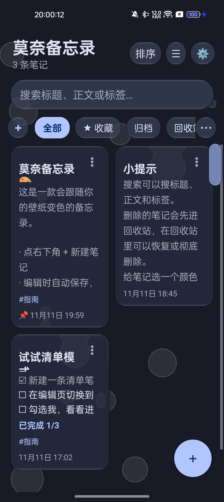
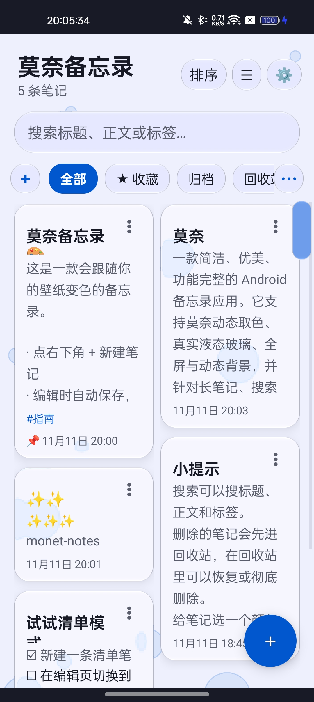
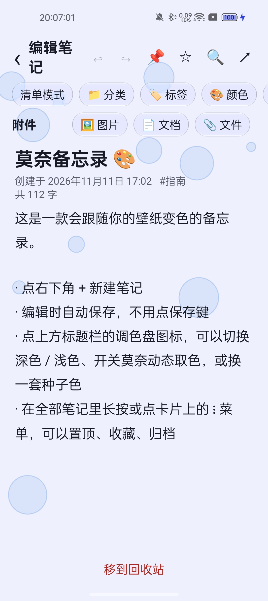
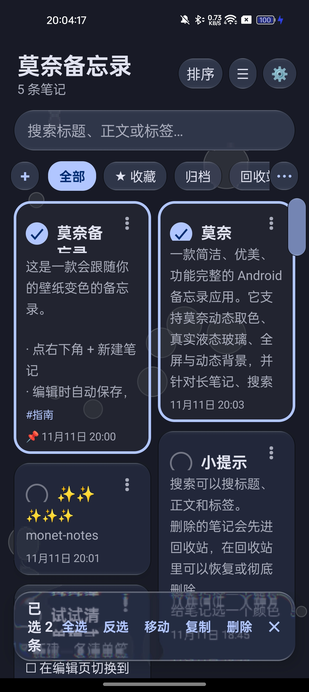
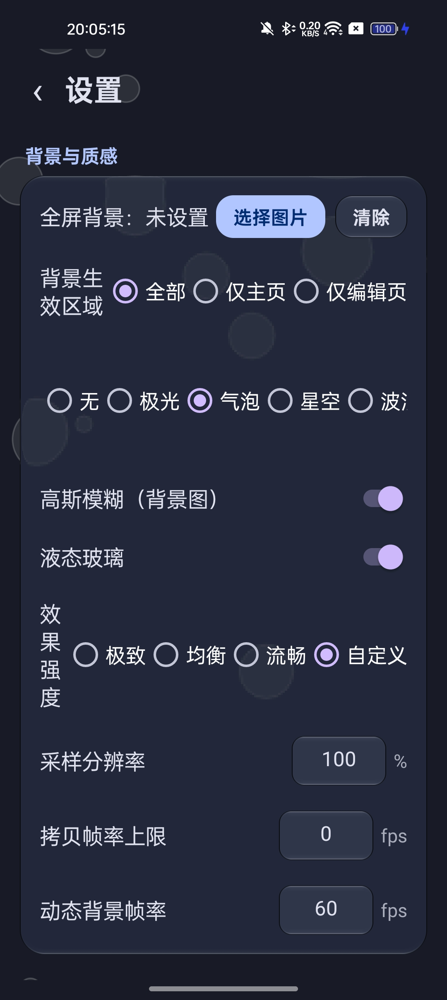
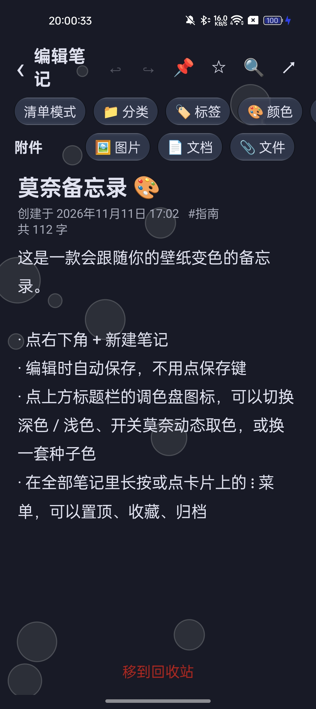

# Monet Notes · 莫奈备忘录

[简体中文](README.md)

A clean, beautiful Android notes app: full-featured, smooth transitions, and Monet dynamic-color theming that follows your wallpaper.
Written in native Java with the Android SDK — **zero third-party dependencies**, APK only ~125 KB.

- Package: `com.muse.monetnotes`
- Min version: Android 8.0 (API 26); Target: Android 14 (API 34)
- Current version: 1.42

## Screenshots

| Home (dark) | Home (light) | Editor (light) |
| --- | --- | --- |
|  |  |  |

| Multi-select | Settings & effect levels | Editor (dark) |
| --- | --- | --- |
|  |  |  |

## Features

**Notes**
- Create / edit / auto-save / word count, checklist mode with completion progress
- Pin, favorite, archive, trash (restore / delete permanently / empty), with undo for deletions
- Search (title / body / tags / categories / attachment names), multiple sort modes including manual ordering
- Multi-select mode: batch move to category / copy / delete, with select-all and invert
- In-note search: highlight matches, jump between hits, replace current / all (undoable)
- Reminders: system notifications at the scheduled time, automatically restored after reboot
- Edit undo / redo (snapshot stack)

**Organization**
- Custom categories: create / edit (icon + name) / delete / long-press drag to reorder, 32 preset emoji icons or any custom icon
- Tags: list-style editor (add/remove one by one, tap to pick frequent tags); copy or move notes between categories (attachments deep-copied)
- Attachments: images / documents / any file (≤ 50 MB each), first-image preview on cards

**Appearance**
- Monet dynamic color (reads the system color scheme on Android 12+), follow system / light / dark, 5 seed colors
- Note colors: presets plus a custom color picker (HSV / hex)
- Full-screen background image (scope: everywhere / home only / editor only), Gaussian blur, and true liquid glass (refraction + dispersion sampled from the real backdrop)
- Dynamic backgrounds: aurora / bubbles / stars / waves / fluid (drawn in theme colors)
- Effect strength: Extreme / Balanced / Smooth / Custom — tune scene sampling resolution, capture FPS cap, and dynamic-background FPS per device
- 6 switchable desktop icons (activity-alias)
- Side quick-scroll bar, one-tap back to top, chunked loading with progress for very long notes
- Swipe left/right to switch categories, multi-language UI (Simplified Chinese / Traditional Chinese / English, follow system)

**Data**
- All data stored in the app's private directory (JSON); export a JSON backup from Settings, or import to restore (merge / overwrite)

## Build

No Gradle — `build.sh` chains aapt2 → javac → d8 → zipalign → apksigner by hand.

Requirements: JDK 17, Android SDK (platform 34, build-tools 34.0.0).

```bash
# 1. Prepare signing (first time only)
keytool -genkeypair -keystore debug.keystore -alias androiddebugkey \
  -keyalg RSA -keysize 2048 -validity 10000 \
  -storepass android -keypass android \
  -dname "CN=Android Debug,O=Android,C=US"

# 2. Point the toolchain paths at your install (edit the env.sh reference
#    at the top of build.sh, or export JAVA_HOME / ANDROID_HOME)
./build.sh
```

Output: `monet-notes-debug.apk` (debug-signed).

## Project structure

```
java/com/muse/monetnotes/   All source (single module, no third-party deps)
  MainActivity              Home: list / filters / multi-select / ordering
  EditorActivity            Editor: body / checklist / attachments / in-note search
  SettingsActivity          Settings page
  Note / NoteStore          Data model and JSON persistence
  Palette                   Monet color and theme palette
  Categories / TagEditor    Categories and tags
  Attachments               Attachment import, opening, thumbnails
  ReminderManager           Reminder scheduling and notifications
  BgHelper / AnimBgView     Full-screen background and dynamic backgrounds
  FastScroll / Ui           Quick-scroll bar and shared control helpers
res/                        Resources (icons, animations, themes)
build.sh                    Build script
```

## License

[MIT](LICENSE)
