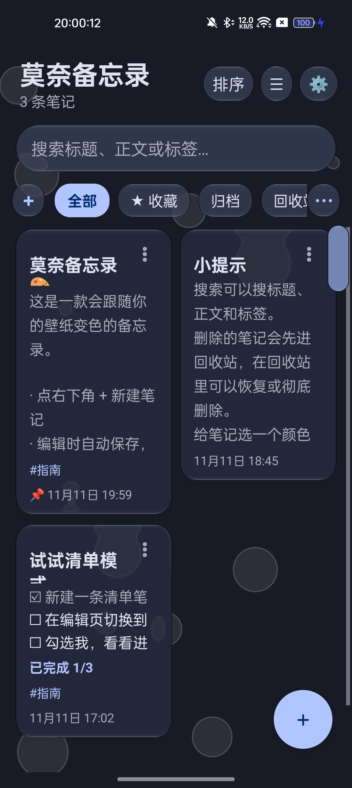
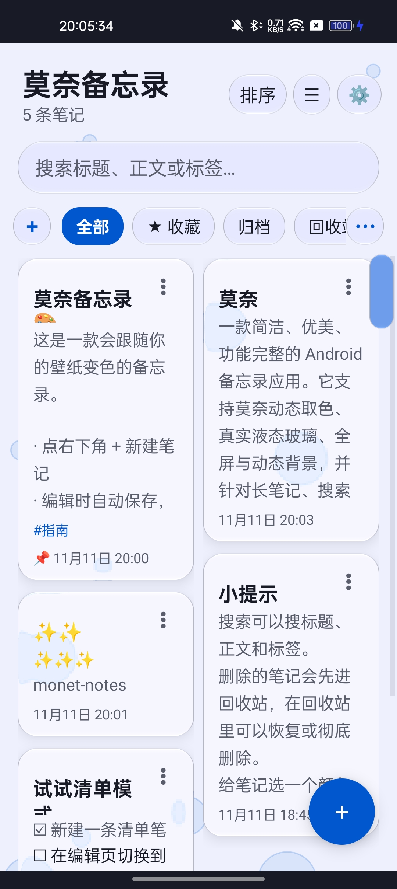
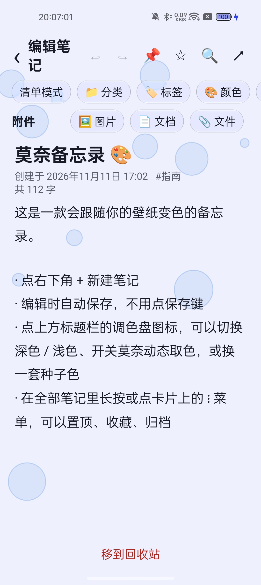
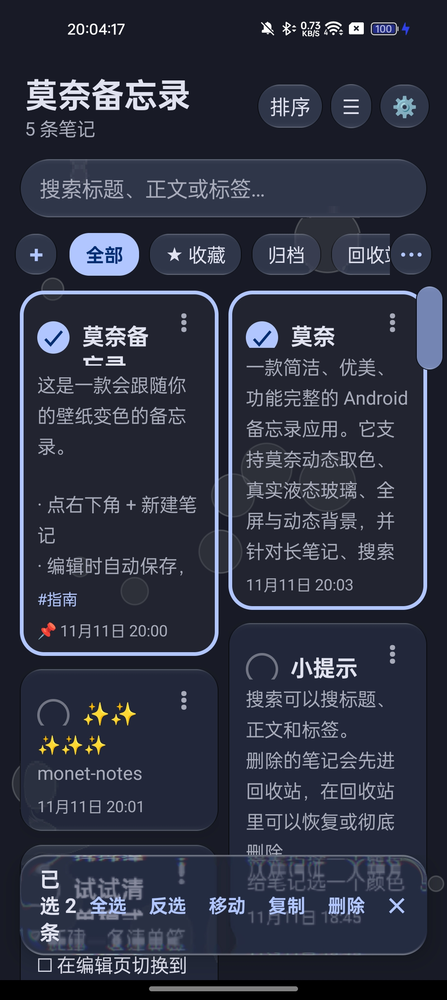
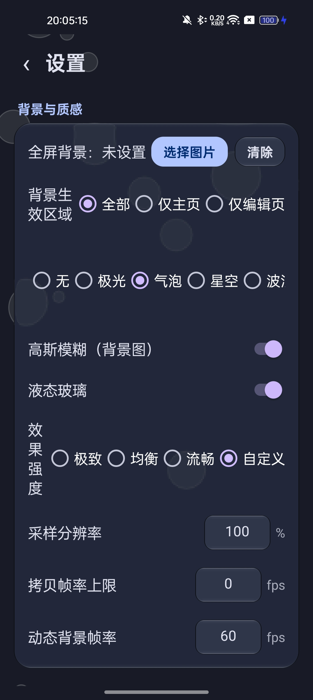
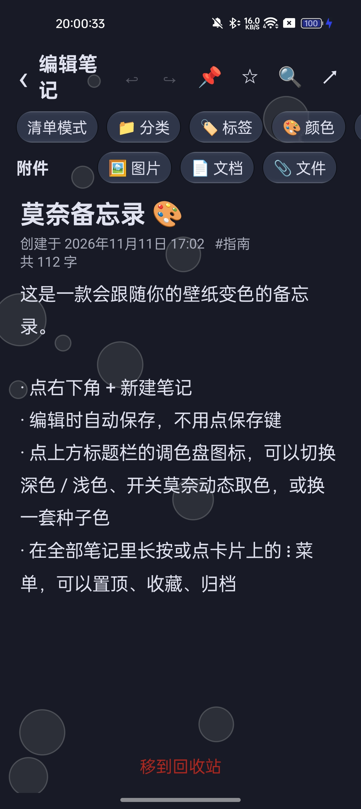

# 莫奈备忘录 · Monet Notes

[English](README.en.md)

一款简洁、优美、功能完整的 Android 备忘录应用。它支持莫奈动态取色、真实液态玻璃、全屏与动态背景，并针对长笔记、搜索和多选操作做了完整的流畅度优化。

项目使用原生 Java 与 Android SDK 编写，**不使用 Gradle、不引入任何第三方依赖**，通过一条手动 Android 构建管线生成约 125 KB 的 APK。

- 包名：`com.muse.monetnotes`
- 当前版本：**1.49**
- 最低版本：Android 8.0（API 26）
- 目标版本：Android 14（API 34）
- 许可证：[MIT](LICENSE)

## 项目亮点

- **莫奈动态取色**：Android 12+ 可读取系统色阶，也可跟随系统、浅色、深色或选择种子色。
- **真实液态玻璃**：Android 13+ 使用 AGSL RuntimeShader 逐像素计算折射、边缘光与色散；浮动的多选栏、撤销栏通过 PixelCopy 采样正下方真实界面，不只是半透明贴图。
- **可调效果强度**：极致、均衡、流畅与自定义四档，可分别设置场景采样分辨率、拷贝帧率上限和动态背景帧率，按设备性能取舍。
- **完整笔记能力**：自动保存、清单、提醒、附件、分类、标签、多选批处理、笔记内查找替换、撤销/重做、导入/导出一应俱全。
- **本地与轻量**：不申请网络权限，笔记与设置保存在应用私有目录；无第三方 SDK、无账号系统。

## 效果图

| 主页（深色） | 主页（浅色） | 编辑页（浅色） |
| --- | --- | --- |
|  |  |  |

| 多选模式 | 设置与效果强度 | 编辑页（深色） |
| --- | --- | --- |
|  |  |  |

## 功能

### 笔记编辑

- 新建、编辑、自动保存与字数统计
- 清单（待办）模式与完成进度
- 置顶、收藏、归档、回收站，以及恢复、彻底删除和清空回收站
- 删除、移动等操作可通过撤销栏恢复
- 编辑撤销 / 重做（快照栈）
- 笔记内搜索：高亮命中、上下跳转、替换当前或全部替换
- Markdown：编辑页格式工具栏（标题 / 粗体 / 斜体 / 删除线 / 引用 / 列表 / 待办 / 代码 / 链接 / 分隔线），编辑时实时样式，顶栏 👁 一键预览渲染效果
- 笔记导出：Markdown / 纯文本 / HTML 网页 / PDF / 长图（PNG）五种格式，可分享或保存到设备任意位置（编辑页工具条与主页卡片菜单均可导出）；超长笔记导出长图时可选择按原字号切成多张连续图片，多张图片还可一键打包成 ZIP
- 提醒通知：到时弹出系统通知，设备重启后自动恢复尚未触发的提醒
- 超长笔记分块载入并显示进度，降低打开和粘贴长文本时的卡顿

### 搜索、组织与批处理

- 全局搜索标题、正文、标签、分类和附件名
- 多种排序方式，包括手动排序
- 多选模式：批量移动到分类、复制、删除，支持全选与反选
- 自定义分类：新建、编辑图标与名称、删除、长按拖动排序
- 标签采用列表式编辑，可逐条增减或点选常用标签
- 笔记复制 / 移动到其他分类时，附件会一并深拷贝
- 附件支持图片、文档和任意文件，单个文件不超过 50 MB，卡片可预览首张图片
- 左右滑动或拖动切换分类，选中的分类会自动滚动到可见区域

### 外观与交互

- 跟随系统 / 浅色 / 深色三种外观模式
- 5 种种子色与莫奈动态取色
- 笔记预设颜色，以及 HSV / 十六进制自定义颜色
- 全屏背景图，可分别控制主页与编辑页的生效范围
- 高斯模糊与液态玻璃可组合使用，弹窗也会跟随主题与玻璃风格
- 五种动态背景：极光、气泡、星空、波浪、流体
- 液态按压形变：按下时卡片横向延展、纵向收缩，圆角、透镜和染色同步变化，松手后弹性回摆
- 6 款可切换的桌面图标
- 侧边快速滚动条与一键回到顶部
- 简体中文、繁體中文、English 三种界面语言，可跟随系统

### 数据管理

- 数据以 JSON 形式保存在应用私有目录
- 设置页可导出全部笔记为 JSON 备份
- 可从备份导入并选择合并或覆盖恢复
- 云备份：WebDAV（可设每天自动备份）与云盘文件夹，备份为包含附件的完整 ZIP，换机可完整恢复
- 请注意：JSON 备份包含笔记与组织数据；附件文件本身的迁移限制会在导入时提示

## 技术实现

- **语言与框架**：原生 Java、Android Views、Android SDK
- **构建方式**：无 Gradle；`build.sh` 手动串联 `aapt2 → javac → d8 → zipalign → apksigner`
- **液态玻璃**：AGSL RuntimeShader、背景切片采样、边缘折射、色散、rim 光、色调自适应与预模糊雾层
- **浮层栏采样**：多选栏和撤销栏位于独立浮窗中，通过 PixelCopy 获取主窗口成品帧；采样管线在后台线程运行，并使用多缓冲避免阻塞主线程
- **性能策略**：动态背景使用全局单一帧驱动；长笔记分块加载；搜索输入防抖；效果强度可按设备性能调节

## 构建

环境要求：

- JDK 17
- Android SDK Platform 34
- Android Build Tools 34.0.0

设置工具链路径后运行：

```bash
export JAVA_HOME=/path/to/jdk-17
export ANDROID_HOME=/path/to/android-sdk
./build.sh
```

`build.sh` 会在缺少 `debug.keystore` 时自动生成本地调试签名。构建产物为：

- `monet-notes-debug.apk`
- `莫奈备忘录-debug.apk`

两者内容相同，均为 debug 签名。

## 目录结构

```text
java/com/muse/monetnotes/   全部源码（单模块，无第三方依赖）
  MainActivity              主页：列表 / 筛选 / 多选 / 排序
  EditorActivity            编辑页：正文 / 清单 / 附件 / 笔记内搜索
  SettingsActivity          设置页
  Note / NoteStore          数据模型与 JSON 持久化
  Palette                   莫奈取色、主题色板与效果强度参数
  Categories / TagEditor    分类与标签
  Attachments               附件导入、打开与缩略图
  ReminderManager           提醒调度与通知
  BgHelper                  背景、场景采样与帧管线
  GlassDrawable             AGSL 液态玻璃渲染
  AnimBgView                动态背景
  FastScroll / Ui           快速滚动条与通用控件工具
res/                        资源（图标、动画、主题）
build.sh                    手动构建脚本
```

## 隐私

莫奈备忘录不申请 Internet 权限，不包含分析、广告或账号 SDK。笔记、附件、背景图与设置均保存在应用自己的私有存储中。

## 许可

本项目采用 [MIT License](LICENSE)。
